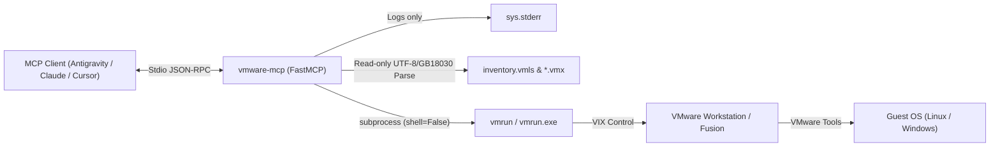

# vmware-workstation-mcp

[](https://github.com/0D0-1yp0/vmware-workstation-mcp-test/actions/workflows/ci.yml)
[](https://www.python.org/downloads/)
[](./LICENSE)
[](https://modelcontextprotocol.io/)

English | [简体中文](./README_CN.md)

> **Note**: This repository (`vmware-workstation-mcp-test`) is a public experimental release for testing and community feedback.

A lightweight, zero-daemon **Model Context Protocol (MCP)** server that lets AI agents (Antigravity, Claude Desktop, Cursor, Windsurf, etc.) control **VMware Workstation Pro / Player / Fusion** through VMware's native `vmrun` utility.

---

## Why This Server?

- **Zero Daemon & Minimal Dependency**: Talks directly to `vmrun` over local Stdio JSON-RPC. No `vmrest` background service, no plaintext `.vmrestCfg` credentials, and only a single Python dependency (`mcp>=1.2.0`).
- **Windows CJK / Non-UTF-8 Safe**: Automatically decodes `inventory.vmls`, `.vmx`, and `vmrun` output with UTF-8 → GB18030/CP936 fallback, preventing `UnicodeDecodeError` and mojibake on Chinese/CJK Windows hosts.
- **Fuzzy VM Name Resolution**: Pass a short name, display name, folder name, or unique keyword (e.g. `"ubuntu-lab"`) instead of typing full `.vmx` paths with spaces or Unicode characters.
- **Strict Stdio Isolation**: All diagnostic logs go exclusively to `sys.stderr`, keeping `sys.stdout` spotless for MCP JSON-RPC framing.
- **Built-in Safety Guardrails**: Intentionally omits `deleteVM`, masks `-gp`/`-vp` passwords in logs/errors, uses `shell=False` subprocess lists, and requires explicit `confirm=True` for destructive or state-discarding actions.

---

## Architecture



---

## Requirements

- **Python**: 3.10 or newer
- **Hypervisor**: VMware Workstation Pro / Player (Windows/Linux) or VMware Fusion (macOS) with `vmrun` installed
- **VMware Tools** *(optional)*: Required inside guest VMs only for guest-level tools (`get_guest_ip`, `run_command_in_guest`, `run_script_in_guest`, `copy_file_*`, `list_processes_in_guest`)

---

## Installation

### Option 1: Install from GitHub

```bash
pip install git+https://github.com/0D0-1yp0/vmware-workstation-mcp-test.git
```

### Option 2: Clone and Install Locally (Editable)

```bash
git clone https://github.com/0D0-1yp0/vmware-workstation-mcp-test.git
cd vmware-workstation-mcp-test
pip install -e .
```

Verify the installation:

```bash
python -m unittest discover -s tests -v
```

---

## MCP Client Configuration

### Antigravity / Claude Desktop / Cursor (`mcp_config.json`)

Using the installed console script (`vmware-mcp`) or module invocation (`python -m vmware_mcp`):

```json
{
  "mcpServers": {
    "vmware-mcp": {
      "command": "python",
      "args": ["-u", "-m", "vmware_mcp"],
      "env": {
        "PYTHONUTF8": "1",
        "PYTHONIOENCODING": "utf-8"
      }
    }
  }
}
```

> **Windows Tip**: If `vmrun.exe` is installed in a non-standard directory or you have multiple Python environments, pass the absolute Python executable path (e.g. `C:\\Python312\\python.exe`) and optionally set `VMWARE_VMRUN_PATH` in `env`.

### Environment Variables (All Optional)

| Variable | Description | Default |
| :--- | :--- | :--- |
| `VMWARE_VMRUN_PATH` | Explicit path to `vmrun` / `vmrun.exe` | Auto-detected via `PATH`, Windows Registry, or standard install paths |
| `VMWARE_HOST_TYPE` | Value passed to `vmrun -T` (`ws`, `fusion`, `player`) | `fusion` on macOS, `ws` on Windows/Linux |
| `VMWARE_VM_DIRS` | Extra VM directories to scan (separated by `;` on Windows or `:` on Unix) | Standard VMware VM folders + `inventory.vmls` |

---

## Available Tools (22)

### 1. Asset Discovery & Status (4)

| Tool | Description |
| :--- | :--- |
| `list_vms` | List all discovered VMs (inventory + folders + running state) with optional `.vmx` hardware specs |
| `list_running_vms` | List currently running VMs via `vmrun list` |
| `get_vm_info` | Get `.vmx` specs, running status, VMware Tools state, and guest IP for a single VM |
| `get_guest_ip` | Query the guest OS IP address (supports `wait=True`) |

### 2. Power Lifecycle (4)

| Tool | Description | Safety Guardrail |
| :--- | :--- | :--- |
| `start_vm` | Start a VM in `gui` or headless `nogui` mode | — |
| `stop_vm` | Power off a VM (`hard=False` soft shutdown or `hard=True` force off) | `hard=True` requires `confirm=True` |
| `reset_vm` | Reboot a VM (`hard=False` soft reboot or `hard=True` hard reset) | `hard=True` requires `confirm=True` |
| `power_state_vm` | `suspend`, `pause`, or `unpause` a VM | — |

### 3. Snapshot Management (4)

| Tool | Description | Safety Guardrail |
| :--- | :--- | :--- |
| `list_snapshots` | List snapshots (flat or `show_tree=True` hierarchy) | — |
| `create_snapshot` | Create a named snapshot | — |
| `revert_to_snapshot` | Revert a VM back to a named snapshot | Requires `confirm=True` |
| `delete_snapshot` | Delete a snapshot (optional `delete_children=True`) | Requires `confirm=True` |

### 4. Guest OS Operations & Diagnostics (6)

| Tool | Description |
| :--- | :--- |
| `run_command_in_guest` | Execute a binary inside the guest OS (`runProgramInGuest`) |
| `run_script_in_guest` | Run inline script text inside the guest OS (`runScriptInGuest`) |
| `list_processes_in_guest` | List running processes inside the guest OS |
| `copy_file_host_to_guest` | Copy a file from host to guest |
| `copy_file_guest_to_host` | Copy a file from guest to host |
| `capture_vm_screen` | Capture the live VM display to a PNG file on the host (great for multimodal agents) |

### 5. Host Networks & Shared Folders (3)

| Tool | Description |
| :--- | :--- |
| `list_host_networks` | List `vmnet*` virtual networks and NAT port forwarding rules |
| `manage_port_forwarding` | Add/update (`set`) or remove (`delete`) NAT port forwarding rules |
| `manage_shared_folder` | `enable`, `disable`, `add`, `remove`, `readonly`, or `writable` Host-Guest shared folders |

### 6. Cloning (1)

| Tool | Description |
| :--- | :--- |
| `clone_vm` | Create a `linked` or `full` clone (optionally from a named snapshot) |

---

## Testing

```bash
# Default offline test suite (unit tests + real MCP stdio protocol handshake, no VMware required)
python -m unittest discover -s tests -v

# Optional read-only live tests against a local VMware installation
RUN_LIVE_VMWARE_TESTS=1 python -m unittest discover -s tests -v
```

---

## Security

See [SECURITY.md](./SECURITY.md) for guardrail details, credential handling, and vulnerability reporting.

## License

Released under the [MIT License](./LICENSE).
