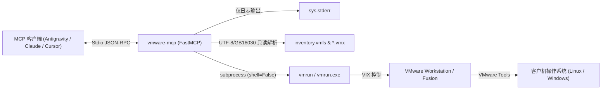

# vmware-workstation-mcp

[](https://github.com/0D0-1yp0/vmware-workstation-mcp-test/actions/workflows/ci.yml)
[](https://www.python.org/downloads/)
[](./LICENSE)
[](https://modelcontextprotocol.io/)

[English](./README.md) | 简体中文

> **说明**：本仓库（`vmware-workstation-mcp-test`）为公开测试发布版本，欢迎试用与反馈。

一个轻量级、免守护进程的 **Model Context Protocol (MCP)** 本地服务端，让 AI Agent（Antigravity、Claude Desktop、Cursor、Windsurf 等）通过 VMware 原生命令行工具 `vmrun` 直接操控 **VMware Workstation Pro / Player / Fusion**。

---

## 核心特性

- **零守护进程、极简依赖**：直接通过本地 Stdio JSON-RPC 桥接 `vmrun`，无需启用 `vmrest` 后台服务或配置明文 `.vmrestCfg` 凭据；运行时仅依赖官方 `mcp>=1.2.0`。
- **Windows 中文环境深度防乱码**：内置 UTF-8 → GB18030/CP936 双重安全解码层，原生解决 Windows 中文系统中 `inventory.vmls` 为 GBK 编码及含中文/空格虚拟机路径导致的崩溃与乱码问题。
- **模糊名称解析 `.vmx`**：支持直接传虚拟机显示名、目录名或唯一关键词（如 `"ubuntu-lab"`），自动定位对应的 `.vmx` 绝对路径。
- **严格 Stdio 协议隔离**：全部日志强制输出至 `sys.stderr`，确保 `sys.stdout` 仅承载纯净 JSON-RPC 帧，杜绝握手失败。
- **内置安全护栏**：默认**禁用 `deleteVM`**（防止永久删盘）；所有子进程以 `shell=False` 参数列表执行防命令注入；`-gp`/`-vp` 密码全程脱敏为 `***`；高危变更操作强制要求 `confirm=True` 二次确认。

---

## 架构概览



---

## 环境要求

- **Python**：3.10 及以上
- **虚拟化软件**：已安装 VMware Workstation Pro / Player（Windows/Linux）或 VMware Fusion（macOS）
- **VMware Tools** *(可选)*：仅在调用客户机内部工具（获取 IP、执行命令/脚本、文件互传、列举进程）时要求客户机已运行 VMware Tools

---

## 快速安装

### 方式一：直接从 GitHub 安装

```bash
pip install git+https://github.com/0D0-1yp0/vmware-workstation-mcp-test.git
```

### 方式二：克隆到本地可编辑安装

```bash
git clone https://github.com/0D0-1yp0/vmware-workstation-mcp-test.git
cd vmware-workstation-mcp-test
pip install -e .
```

运行离线自检测试：

```bash
python -m unittest discover -s tests -v
```

---

## 客户端接入配置

### Antigravity / Claude Desktop / Cursor (`mcp_config.json`)

```json
{
  "mcpServers": {
    "vmware-mcp": {
      "command": "python",
      "args": ["-u", "-m", "vmware_mcp"],
      "env": {
        "PYTHONUTF8": "1",
        "PYTHONIOENCODING": "utf-8"
      }
    }
  }
}
```

> **Windows 提示**：如果 `vmrun.exe` 未加入系统 `PATH`（本工具会自动查询 Windows 注册表与常见安装目录），或机器上有多个 Python 环境，建议将 `command` 写成绝对路径（例如 `C:\\Python312\\python.exe`），必要时可在 `env` 中显式指定 `VMWARE_VMRUN_PATH`。

### 可选环境变量

| 变量名 | 说明 | 默认行为 |
| :--- | :--- | :--- |
| `VMWARE_VMRUN_PATH` | 手动指定 `vmrun` / `vmrun.exe` 绝对路径 | 自动依次探测 `PATH`、Windows 注册表与常见安装目录 |
| `VMWARE_HOST_TYPE` | 传给 `vmrun -T` 的宿主类型（`ws` / `fusion` / `player`） | macOS 默认 `fusion`，Windows/Linux 默认 `ws` |
| `VMWARE_VM_DIRS` | 追加扫描的虚拟机根目录（Windows 用 `;` 分隔，Linux/macOS 用 `:`） | 默认合并 `inventory.vmls` 与常见虚拟机目录 |

---

## 工具列表（共 22 个）

### 1. 资产发现与状态（4 个）

| 工具名 | 功能说明 |
| :--- | :--- |
| `list_vms` | 列出本机所有虚拟机（合并清单、目录扫描与运行态），可选解析 `.vmx` 规格 |
| `list_running_vms` | 调用 `vmrun list` 返回当前运行中的虚拟机 |
| `get_vm_info` | 查看单台 VM 的 `.vmx` 硬件配置、运行状态、VMware Tools 状态与客户机 IP |
| `get_guest_ip` | 获取运行中客户机的 IP 地址（支持 `wait=True` 等待就绪） |

### 2. 电源生命周期（4 个）

| 工具名 | 功能说明 | 安全护栏 |
| :--- | :--- | :--- |
| `start_vm` | 启动虚拟机（支持 `gui` 窗口或 `nogui` 后台无头启动） | — |
| `stop_vm` | 关机（`hard=False` 软关机 / `hard=True` 强制断电） | `hard=True` 须 `confirm=True` |
| `reset_vm` | 重启（`hard=False` 软重启 / `hard=True` 硬复位） | `hard=True` 须 `confirm=True` |
| `power_state_vm` | 挂起（`suspend`）、暂停（`pause`）或恢复（`unpause`） | — |

### 3. 快照管理（4 个）

| 工具名 | 功能说明 | 安全护栏 |
| :--- | :--- | :--- |
| `list_snapshots` | 查看快照清单（支持 `show_tree=True` 树状展示） | — |
| `create_snapshot` | 创建命名快照 | — |
| `revert_to_snapshot` | 回滚至指定快照 | 须 `confirm=True` |
| `delete_snapshot` | 删除指定快照（支持 `delete_children=True`） | 须 `confirm=True` |

### 4. 客户机操控与排障（6 个）

| 工具名 | 功能说明 |
| :--- | :--- |
| `run_command_in_guest` | 在客户机中执行程序（`runProgramInGuest`） |
| `run_script_in_guest` | 在客户机中直接执行脚本片段（`runScriptInGuest`） |
| `list_processes_in_guest` | 列出客户机当前运行进程 |
| `copy_file_host_to_guest` | 宿主机传文件至客户机 |
| `copy_file_guest_to_host` | 客户机拉取文件至宿主机 |
| `capture_vm_screen` | 截取虚拟机实时屏幕为宿主机 PNG 文件（便于多模态 Agent 直接看画面） |

### 5. 宿主机网络与共享文件夹（3 个）

| 工具名 | 功能说明 |
| :--- | :--- |
| `list_host_networks` | 列出 `vmnet*` 虚拟网络及 NAT 端口转发规则 |
| `manage_port_forwarding` | 新增/更新（`set`）或删除（`delete`）NAT 端口转发规则 |
| `manage_shared_folder` | 启用/禁用/添加/移除/设置只读或可写共享文件夹 |

### 6. 虚拟机克隆（1 个）

| 工具名 | 功能说明 |
| :--- | :--- |
| `clone_vm` | 创建链接克隆（`linked`）或完整克隆（`full`），支持指定源快照 |

---

## 本地测试

```powershell
# 默认离线测试（单元测试 + 真实 MCP Stdio 协议握手，无需安装 VMware）
$env:PYTHONUTF8 = "1"; $env:PYTHONIOENCODING = "utf-8"
python -m unittest discover -s tests -v

# 可选：在本机已安装 VMware Workstation 时运行只读实机集成测试
$env:RUN_LIVE_VMWARE_TESTS = "1"
python -m unittest discover -s tests -v
```

---

## 安全说明

详见 [SECURITY.md](./SECURITY.md)。

## 开源协议

基于 [MIT License](./LICENSE) 开源。
